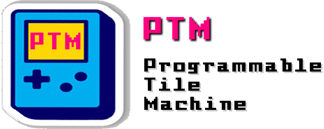

# PTM - Programmable Tile Machine

__PTM (Programmable Tile Machine)__ is a "pseudo-8-bit fantasy computer" that you can program using a built-in programming language called PTML. The system aims to be similar in look-and-feel to some early 8-bit computer systems with low-resolution and tile-based displays, such as the MSX, ZX Spectrum and Atari 800. Also inspired by the modern game engines Bitsy and PICO-8.

__PTML__ is an interpreted, imperative, loosely typed, line-based, low-level programming language, with only two basic data types: strings and integers, with support for fixed-size arrays. The syntax is based on early, unstructured dialects of BASIC and also Assembly languages for 8-bit computers (sometimes resembling Zilog Z80 code). PTML has approximately 100 commands.

## Version history

This project is currently in beta stage. All beta versions may contain bugs!

| **Version** | **Release date** | **Comments** |
|-------------|------------------|--------------|
| **0.3**     | _TBA_ | Current implementation, started from scratch. PTML is an entirely different language from earlier versions. |
| **0.2**     | _July 1, 2023_ | Many PTML improvements and new commands. This version also included a few standalone tools (PTM Studio and PTM Tile Editor) besides the main PTM interpreter. |
| **0.1**     | _May 14, 2023_ | First release. Ranked 4th out of 61 entries in the [Tool Jam 3](https://itch.io/jam/the-tool-jam-3/results). |

## Downloads

You can download pre-built PTM releases on Itch.io here: https://fernandoairescastello.itch.io/ptm

The latest released version is __0.2__.  
The current development version is __0.3__.
